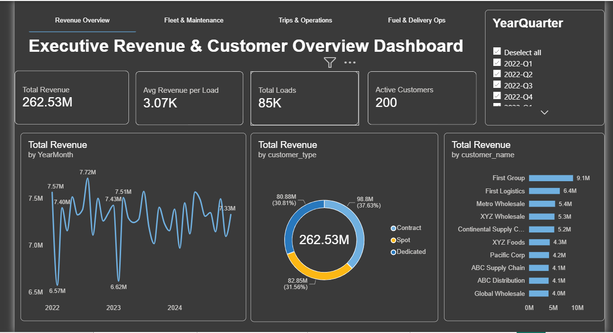
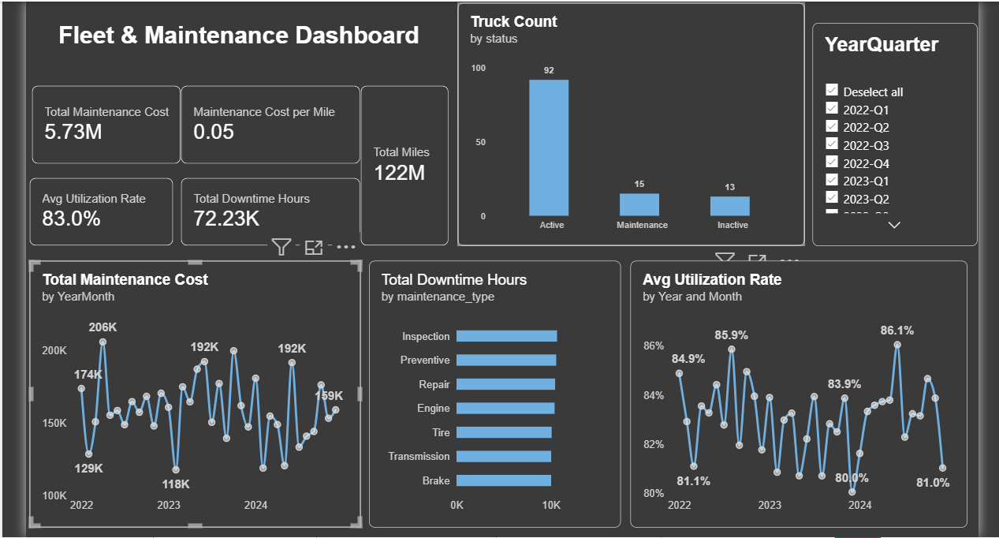
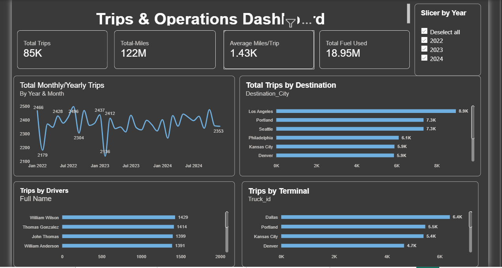
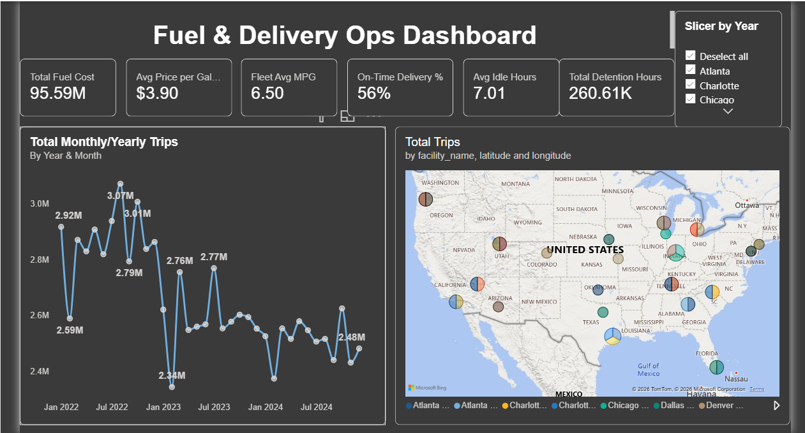

# 🚚 Logistics Operations Analytics Dashboard

**An end-to-end Power BI analysis of revenue, fleet maintenance, trip operations, and fuel & delivery performance for a US trucking company, built on 3 years of data (Jan 2022 to Dec 2024) and 85,410 completed loads.**


---

## 📌 Project Overview

Logistics companies run on thin margins. Revenue, fleet health, fuel spend, and on-time delivery all pull against each other, and leadership needs one place to see them together.

This capstone turns 14 raw operational tables into a **four-page interactive Power BI dashboard** that answers the questions an operations or finance leader asks every week:

- How much revenue are we generating, and from which customers and booking types?
- Is our fleet healthy, and how much do downtime and maintenance cost us?
- Where do trips go, and which drivers and terminals carry the volume?
- How much are we spending on fuel, and are we delivering on time?

---

## 🎯 Business Objectives

1. Give executives a single view of revenue performance and customer concentration.
2. Track fleet utilization, maintenance cost, and downtime to reduce avoidable losses.
3. Monitor trip volume, mileage, and fuel consumption across destinations, terminals, and drivers.
4. Measure delivery reliability (on-time %, idle time, detention time) and find where it breaks down.

---

## 🗂 Dataset

| Item | Detail |
|---|---|
| Source | Web|
| Period | 1 Jan 2022 to 31 Dec 2024 |
| Format | 14 CSV files (about 68 MB uncompressed) |
| Scale | 85,410 loads and trips · 170,820 delivery events · 196,442 fuel purchases · 200 customers · 150 drivers · 120 trucks · 180 trailers · 50 facilities · 58 routes |

### Tables

| Type | Table | Rows | Description |
|---|---|---:|---|
| Fact | `loads` | 85,410 | Revenue, fuel surcharge, accessorial charges, load type, booking type |
| Fact | `trips` | 85,410 | Distance, duration, fuel used, MPG, idle time, assigned driver/truck/trailer |
| Fact | `delivery_events` | 170,820 | One pickup and one delivery event per load, with on-time flag and detention minutes |
| Fact | `fuel_purchases` | 196,442 | Gallons, price per gallon, total cost, location |
| Fact | `maintenance_records` | 2,920 | Maintenance type, labor and parts cost, downtime hours |
| Fact | `safety_incidents` | 170 | Incident type, fault/preventable flags, claim amounts |
| Fact | `truck_utilization_metrics` | 3,312 | Monthly utilization, miles, and downtime per truck |
| Fact | `driver_monthly_metrics` | 4,464 | Monthly trips, MPG, on-time rate, and idle hours per driver |
| Dimension | `customers` | 200 | Name, customer type (Contract, Spot, Dedicated), credit terms |
| Dimension | `drivers` | 150 | Employment status, home terminal, CDL class, experience |
| Dimension | `trucks` | 120 | Make, model year, status, home terminal |
| Dimension | `trailers` | 180 | Trailer type, status, location |
| Dimension | `facilities` | 50 | Type, city, state, latitude/longitude (powers the map) |
| Dimension | `routes` | 58 | Origin, destination, distance, base rate per mile |

> `fuel_purchases.xlsx` in the original download is a duplicate of `fuel_purchases.csv`, so only the CSV is used.

### Data Quality Checks

| Check | Result | Handling |
|---|---|---|
| Duplicate rows | None in any table | None needed |
| Missing `driver_id`, `truck_id`, `trailer_id` on trips | About 2% of trips (1,714 / 1,672 / 1,680) | Kept in revenue and mileage totals; excluded from driver- and truck-level views |
| Missing `truck_id` / `driver_id` on fuel purchases | 3,880 / 3,988 rows | Kept in company-level fuel cost; excluded from per-truck and per-driver views |
| Date format | Dates stored as `dd/mm/yyyy` text | Converted to true date type in Power Query |
| Referential integrity | Every fuel purchase and delivery event maps to a valid trip/load | No orphan records |
| Termination dates | Blank for the 124 active drivers (expected) | Left as null |

---

## 🛠 Tools & Skills

- **Power BI Desktop**: data modelling, interactive visuals, slicers, page navigation
- **Power Query**: cleaning, type conversion, and transformation
- **DAX**: measures such as revenue per load, maintenance cost per mile, utilization rate, and on-time delivery %
- **Data modelling**: star schema with a shared date dimension
- **Python (pandas)**: used to profile and validate the raw data

---

## 🔄 Approach

1. **Profile the data**: checked row counts, nulls, duplicates, and key relationships across all 14 tables.
2. **Clean and transform**: converted date columns, set data types, and handled missing IDs (Power Query).
3. **Model**: connected fact tables to dimension tables (customers, drivers, trucks, facilities, dates) in a star schema.
4. **Build measures**: wrote DAX for every KPI card.
5. **Design the dashboard**: four themed pages with KPI cards on top and trend/breakdown charts below.
6. **Add interactivity**: year and year-quarter slicers, a city slicer, and top navigation tabs.
7. **Validate**: reconciled dashboard totals against the raw files (revenue, miles, fuel, maintenance, and on-time % all match).

---

## 📊 Dashboard Walkthrough

### 1. Executive Revenue & Customer Overview



| KPI | Value |
|---|---|
| Total Revenue | **$262.53M** |
| Avg Revenue per Load | **$3.07K** |
| Total Loads | **85K** |
| Active Customers | **200** |

Visuals: monthly revenue trend, revenue by customer type (Contract $98.8M, Spot $82.9M, Dedicated $80.9M), and top customers by revenue.

### 2. Fleet & Maintenance



| KPI | Value |
|---|---|
| Total Maintenance Cost | **$5.73M** |
| Maintenance Cost per Mile | **$0.05** |
| Avg Utilization Rate | **83.0%** |
| Total Downtime Hours | **72.23K** |
| Total Miles | **122M** |

Visuals: truck count by status, monthly maintenance cost, downtime hours by maintenance type, and utilization trend.

### 3. Trips & Operations



| KPI | Value |
|---|---|
| Total Trips | **85K** |
| Total Miles | **122M** |
| Avg Miles per Trip | **1.43K** |
| Total Fuel Used | **18.95M gallons** |

Visuals: monthly/yearly trips, trips by destination city, trips by driver, and trips by terminal.

### 4. Fuel & Delivery Operations



| KPI | Value |
|---|---|
| Total Fuel Cost | **$95.59M** |
| Avg Price per Gallon | **$3.90** |
| Fleet Avg MPG | **6.50** |
| On-Time Delivery % | **56%** |
| Avg Idle Hours per Trip | **7.01** |
| Total Detention Hours | **260.61K** |

Visuals: monthly trip trend and a map of trips by facility.

---

## 🔍 Key Findings

1. **Delivery reliability is the biggest problem.** Only **56%** of pickup and delivery events are on time. Splitting them shows pickups are on time **67%** of the time, but **deliveries only 45%**, so most lateness happens at the delivery end.
2. **Delays are systemic, not tied to one facility type.** On-time rates are nearly identical across cross-docks, distribution centers, terminals, and warehouses (about 55% to 56%), and average detention is about 91 minutes at all of them. This points to network-wide scheduling and appointment practices rather than one weak site.
3. **Revenue is flat.** Annual revenue was $87.9M (2022), $87.0M (2023), and $87.7M (2024), with load volume steady at about 28K to 29K per year. The business is stable but not growing.
4. **Dedicated freight is busy but low-value.** Dedicated accounts for **50% of loads** (42,337) but only **31% of revenue**, or about **$1,910 per load**, compared with about **$4,590** for Contract and **$3,850** for Spot.
5. **Customer concentration risk is low.** The largest customer (First Group) is about 3.5% of revenue, and the top five customers together are about 12%.
6. **Fuel is the largest controllable cost.** Fuel spend of $95.59M equals about **36% of revenue** (roughly $0.78 per mile), versus about 2% for maintenance. Fuel surcharges ($29.98M) recover only about 31% of fuel cost.
7. **Fuel purchased exceeds fuel burned.** Fuel purchase records total **24.5M gallons**, but trips record only **18.95M gallons** used, a gap of about 5.6M gallons (29%). This is worth reconciling, since it could indicate recording gaps, idling or non-trip use, or leakage.
8. **Maintenance is cheap per mile, but downtime is spread across every category.** Cost is only $0.05 per mile, and downtime hours are split almost evenly across seven maintenance types (about 10K to 10.7K hours each), with Inspection and Preventive highest.
9. **Nearly a quarter of the fleet is not earning.** Of 120 trucks, 92 are active, 15 are in maintenance, and 13 are inactive (about 23% not in service), while utilization of the active fleet averages 83%.
10. **Volume is concentrated in a few lanes.** Los Angeles is the top destination (about 8.9K trips), followed by Portland and Seattle (about 7.3K each). Driver workloads are well balanced, with the busiest drivers at roughly 1,390 to 1,430 trips each.

---

## 💡 Recommendations

1. **Fix delivery-side timeliness first.** Work with top customers on delivery appointment windows and detention fees, since the 45% delivery on-time rate drives the overall 56%.
2. **Cut fuel cost and investigate the gallon gap.** Reconcile purchased versus used gallons, apply idle-reduction and fuel-card controls, and use driver coaching to lift MPG above 6.5.
3. **Re-price or restructure Dedicated freight.** At about $1,910 per load, Dedicated lanes may be under-priced relative to the effort. Review rates and minimum charges.
4. **Raise fuel surcharge recovery.** Recovering only about 31% of fuel cost leaves margin exposed when fuel prices rise.
5. **Return or retire idle trucks.** Decide whether the 13 inactive units should go back into service or be sold to cut fixed costs, and shorten time in the shop for the 15 in maintenance.
6. **Plan for growth.** With revenue flat for three years, target new Contract business, which earns the most per load.

---

## 🚀 Next Steps / Future Work

- Add a **Safety** page using `safety_incidents` (170 incidents, about 38% preventable, about $2.65M in claims).
- Add a **Driver Performance** page using `driver_monthly_metrics`.
- Build a **fuel reconciliation** view comparing purchased and consumed gallons by truck.
- Forecast monthly revenue and load volume.

---

## 📁 Repository Structure

```
logistics-analytics-dashboard/
├── README.md
├── data/
│   └── raw/
│       ├── customers.csv
│       ├── delivery_events.csv
│       ├── driver_monthly_metrics.csv
│       ├── drivers.csv
│       ├── facilities.csv
│       ├── fuel_purchases.csv
│       ├── loads.csv
│       ├── maintenance_records.csv
│       ├── routes.csv
│       ├── safety_incidents.csv
│       ├── trailers.csv
│       ├── trips.csv
│       ├── truck_utilization_metrics.csv
│       └── trucks.csv
├── powerbi/
│   └── logistics_dashboard.pbix
└── images/
    ├── dashboard_overview.png
    ├── 1_revenue_overview.png
    ├── 2_fleet_maintenance.png
    ├── 3_trips_operations.png
    └── 4_fuel_delivery.png
```

---

## ▶️ How to Explore the Project

1. Clone or download this repository.
2. Open `powerbi/logistics_dashboard.pbix` in **Power BI Desktop** (free from Microsoft).
3. If prompted, point the data source to the files in `data/raw/` (Home → Transform data → Data source settings).
4. Use the **year/quarter slicers** and **page tabs** at the top to explore.

---

## 👤 Author

**Innocent Felix Eichie**
Data Analyst | Lagos, Nigeria

Phone: +234 906 4069 074· 📧 [Email] eichie.inno@gmail.com · 💼 [More projects]
